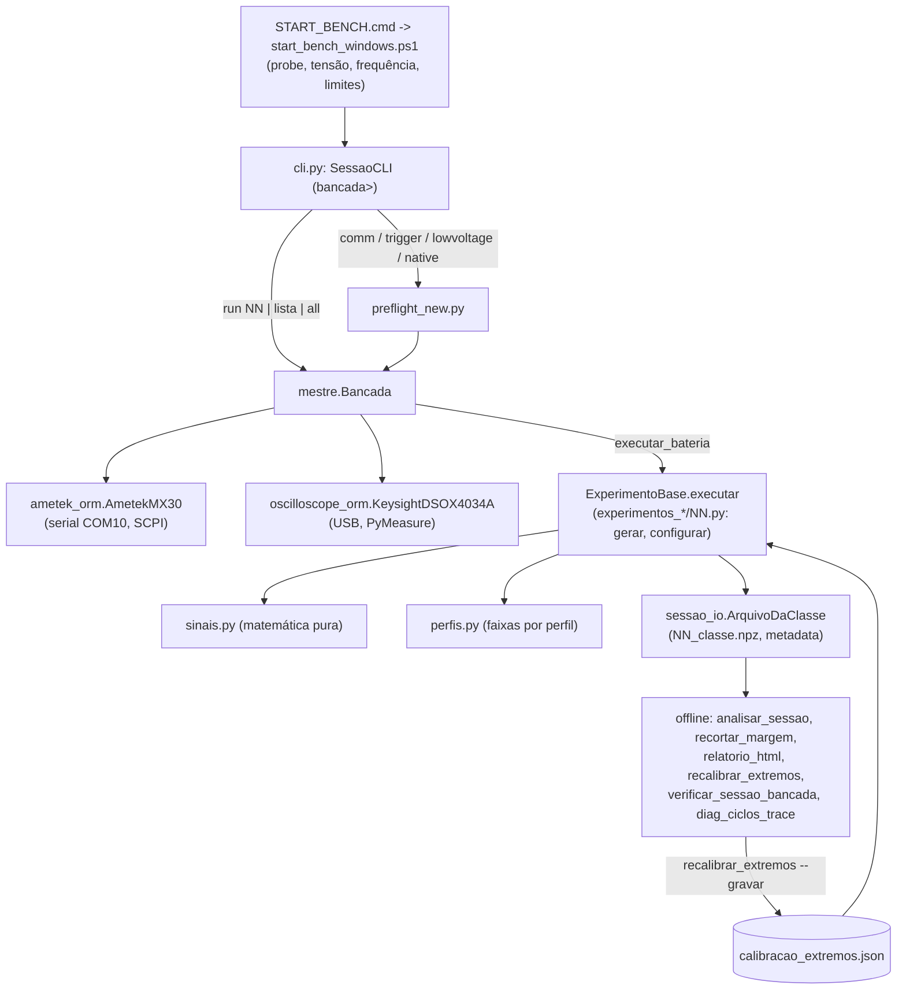

# 06. Mapa do código

Base: `main` em `fa82f49` (v1.15 em andamento), lida em 2026-10-15. Todo `arquivo:linha` abaixo foi conferido com `ast` ou leitura direta nesta data; onde um símbolo é citado por linha, o site deve gerar a linha a partir do símbolo (as citações dos `docs/` atuais envelheceram: ver `01-inventario.md` §5). "Hoje" = `fa82f49`. Fatos que dependem da bancada trazem o selo (NÃO VERIFICADO etc.).

Tamanho: `logica/` 12 módulos Python (11.094 linhas) + `calibracao_extremos.json` + `modelos/relatorio_capturas.html`; `experimentos_nativos/` 7 classes e `experimentos_waveform/` 13 classes (989 linhas); `scripts/` 6 `.ps1`/`.cmd` e 12 `.py`; `tests/test_offline.py` 9.429 linhas, 66 classes `unittest.TestCase` (71 com os auxiliares), 497 testes.

## 1. A pirâmide em uma página

Regra de dependência (mantida por convenção, não por ferramenta): `sinais.py`, `perfis.py` e `sessao_io.py` não importam `mestre` nem hardware; `ametek_orm.py` e `oscilloscope_orm.py` não importam `mestre`; só `mestre.py` conhece os dois instrumentos; só `cli.py` e os scripts de bancada mexem nas variáveis de módulo de `mestre` (estado de sessão). `mestre.py` importa `ametek_orm`, `perfis`, `sessao_io`, `sinais` (`mestre.py:21-30`) e carrega `oscilloscope_orm` só dentro de `Bancada.from_env` (`:1070-1073`), por isso o modo simulado roda sem PyMeasure.

## 2. Fluxos de controle

### 2.1 Do operador à captura (bancada)

1. `START_BENCH.cmd` (`scripts/START_BENCH.cmd:5`) chama `start_bench_windows.ps1` sem perfil de usuário e com `ExecutionPolicy Bypass`.
2. O `.ps1` (`:11`) roda `setup_windows.ps1` (venv `env\`, Python 3.9-3.12, `pip install -r requirements.txt`), carrega `bench_config.ps1` (`:15`: `BENCH_MODE=1`, `ARM_OUTPUT=NO`, `AMETEK_CLEAR_USER_WAVEFORMS=1`), pergunta probe (`:17-29`), tensão (`:36-45`) e frequência (`:47-56`), recusa tensão > 270 V (`:83-93`) e **sobrescreve** `SOURCE_VOLTAGE_RANGE_RMS`, `EUT_MAX_VOLTAGE_RMS` (300) e `EUT_MAX_PEAK_V` (415,8 = 98 % de 300·√2) (`:94-101`). Depois executa `logica/cli.py` (`:116`). As variáveis viram constantes de módulo quando `mestre.py` é importado (`mestre.py:325,402-415`): mudar tensão exige reiniciar o processo.
3. `SessaoCLI.loop` (`cli.py:962-995`) despacha por `COMANDOS` (`:950-960`); `set` só altera globais de `mestre` (`cli.py:527-672`).
4. `run`: `cmd_run` (`:717-726`) → `_run_uma` (`:755-807`) ou `_run_lista` (`:728-753`) / `_run_all` (`:809-826`) → `_executar_scripts` (`:828-860`). Em todos, a ordem é: confirmação digitada (`confirmar`, `:344-351`), pasta de sessão nova (`_garantir_pasta_sessao`, `:283-311`), `autorizar_saida(True)` (`:271-281`), `Bancada.from_env(require_output=True)`, execução, `autorizar_saida(False)` no `finally`, ganchos de fim de run (`_fim_da_sessao`, `:864-885`).
5. `Bancada.from_env` (`mestre.py:1031-1139`): `validate_bench_configuration` → `AmetekMX30(...)` (o construtor chama `connect`, que manda `OUTPut:STATe OFF` antes de qualquer outra coisa e confere o `*IDN?`, `ametek_orm.py:334-364`) → `configure_safe_baseline` (22 comandos, cada um seguido de `check_errors`, `:1212-1301`) → `clear_all_traces` se `AMETEK_CLEAR_USER_WAVEFORMS` (só com a saída desligada, `:1303-1317`) → Keysight (`VISAAdapter`, `verify_identity`, `initialize_safe`) → `garantir_ctrl_c_no_windows` (**depois** de abrir os dois: o NI-VISA instala o seu tratador ao abrir) → canais, aquisição, trigger externo → `authorize_output` + `energize_baseline` (só com `require_output` e `ARM_OUTPUT=YES`) → `verificar_cadeia_de_medicao`.

### 2.2 Uma classe (`ExperimentoBase.executar`, `mestre.py:2578-2863`)

`dimensionar_capturas` (`:1684-1701`) → `plano_de_capturas` (`:1709-1717`) → na bancada, `_indices_viaveis` (`:2123-2167`; pula o que não cabe, `ParameterOutOfBoundsError` se nada cabe) → `_calcular_margem` (`:2315-2328`: 600 + 6000 + 1500 = 8100 amostras) → `osc.configure_acquisition(pre_trigger = pre_trigger_s + margem_antes)` (`:2611-2616`) → `_iniciar_gravacao_incremental` (`:2418-2437`). Para cada captura do plano: `seed_da_captura` (`:1703-1707`) → `rng` → simulado: `gerar()`; bancada: `_capturar_real` dentro de `try ... except ERROS_CAPTURA_DESCARTAVEL` (`:2673-2692`: descarta só a captura) → metadata → `_contexto_da_sessao` (`:1735-1788`) → `_gravar_diagnostico_trace` → `_medir_extremos_fisicos` → `ruido_na_janela` (AWGN só na janela rotulada) → `pre_trigger_desvio_amostras` → `_validar_fisicamente` (`:1827-1894`) → `_salvar_captura` (`:2439-2487`; spool atômico por captura) → só **depois** `_conferir_extremos_fisicos` (`:1962-1979`; a captura que passou do teto fica gravada como evidência). No fim: `restaurar_forma_e_modo_padrao` e `_finalizar_gravacao`; se todas as capturas foram perdidas, a classe levanta (`:2837-2854`).

`_capturar_real` nativa (`:2936-2983`): `gerar()` (fonte da verdade da posição) → pré-trigger sorteado → `definir_fase_de_disparo` → `configurar()` → `osc.arm()` + `wait_for_armed()` → `fonte.arm()` (readback) → `fonte.trigger()` (`*TRG`) → esperas → `_ler_captura`. Waveform (`:3126-3188`): `gerar()` → `forma_para_bancada()` (limite de pico e de bancada) → `program_capture()` → `set_vertical_scale` → `osc.arm()` → `fonte.arm_transient()` → `trigger` → esperas → `_ler_captura` → `_ler_traces_de_diagnostico`.

### 2.3 Depois da sessão (offline, sem hardware)

`sessao_io.ler_capturas` é o leitor único (formatos 1 e 2). `analisar_sessao` (`:216-333`) reconstrói o esperado por `gerar()` + seed do metadata e mede lag, correlação, correlação do distúrbio (nominal e com fundamental ajustada) e razão de pico; `recortar_margem` grava `sem_margem/`; `relatorio_html` gera o HTML; `recalibrar_extremos` recalcula `calibracao_extremos.json`; `verificar_sessao_bancada` e `diag_ciclos_trace` conferem fase da 18, largura do PULSe, pré-trigger e ciclos trocados.

## 3. Invariantes e camadas de segurança (independentes entre si)

| # | Camada | Onde (hoje) | Invariante |
|---|---|---|---|
| 1 | Porta e baud fixos, probe obrigatória, `BASE ≤ EUT_MAX ≤ range`, `ARM_OUTPUT=YES` só durante o comando | `mestre.py:418-439`; `ametek_orm.py:339-340` | com `BENCH_MODE=1`, `COM10` e 115200 ou erro; probe ausente ou ≤ 0 é erro |
| 2 | Primeira ação ao abrir a fonte é `OUTPut:STATe OFF`; `*IDN?` conferido contra `AMETEK_EXPECTED_MODEL` | `ametek_orm.py:334-364` | nada energiza sem passar por `energize_baseline` |
| 3 | Limites no construtor e nos setters/métodos semânticos | `ametek_orm.py:194-221` (`max_peak_v = min(…, 425)`), `735-772`, `883-887`, `912-919`, `944-948`, `1114-1121` | fora do limite → `ParameterOutOfBoundsError` (também `ValueError`) |
| 4 | Interlock de software da saída | `ametek_orm.py:687-726` | `output_enabled = True` sem `authorize_output` → `PermissionError` |
| 5 | Fila SCPI após cada passo relevante | `ametek_orm.py:633-655,1281-1290,1650-1654` | erro na fila vira `InstrumentHardwareError`; 20 erros sem esvaziar também |
| 6 | Pré-validação antes de qualquer SCPI | `mestre.py:2063-2167` | rms ≤ 300 V, rms·√2 ≤ `max_peak_v`, extremo previsto ≤ teto (1,0 × `max_peak_v`; 0,9 na 08) |
| 7 | Readback do transiente antes de armar | `ametek_orm.py:1782-1821` (nativo, 5 consultas, 0,5 %), `:1845-1880` (LIST, 9 consultas) | divergência recusa a captura |
| 8 | Extremos medidos depois da captura | `mestre.py:1945-1979`; `oscilloscope_orm.py:181-207` | acima do teto: `PicoFisicoExcedidoError` depois de gravar; classe para sem retry |
| 9 | Cadeia de medição antes da 1.ª classe | `mestre.py:1496-1533` | fonte ±5 % da base e CH1/fonte ±10 % ou `CadeiaDeMedicaoError` |
| 10 | Validações de formato do dado | `ametek_orm.py:1433-1434`; `oscilloscope_orm.py:458-512`; `mestre.py:2276-2290` | 6000 amostras finitas; preamble de 10 campos; BYTE; ≥ 6000 pontos; sem código 0 nem 1/255; ≥ 30 kSa/s |
| 11 | Confirmação digitada, case-sensitive, por comando que energiza | `cli.py:344-351,691,706,750,762,823`; scripts `diag_*` | `ENERGIZAR-TESTE`, `ENERGIZAR-COMANDOS`, `EXECUTAR-CLASSE-NN`, `EXECUTAR-CLASSES-<lista>`, `EXECUTAR-20-CLASSES`, mais as dos diagnósticos |
| 12 | Falha de infraestrutura aborta, de experimento isola | `mestre.py:1206-1228,1231-1341` | `CommunicationError`/`FalhaFatalDeInstrumento` propagam sem retry; `ERROS_DETERMINISTICOS` não retentam; `Exception` genérica até 3 tentativas |
| 13 | Desligamento | `ametek_orm.py:1937-1961`; `mestre.py:1021-1028` | `ABORt` + `OUTPut:STATe OFF` + leitura; ver armadilha 5 |
| 14 | Ctrl+C no Windows | `mestre.py:445-481` | tratador de console chama `_thread.interrupt_main`; só na `Bancada` (não cobre o `native` do `preflight_new`) |

## 4. Módulo a módulo

### 4.1 `logica/mestre.py` (3294 linhas): orquestrador

**Responsabilidade.** Configuração global (variáveis de ambiente → constantes), `Config`, `Bancada`, `ExperimentoBase/Nativo/Waveform`, pré-validação e validação física, calibração de extremos, sorteio, gravação, `main()` do dataset simulado.

| Bloco | Símbolos principais (linha de definição) |
|---|---|
| Log e procedência | `_HandlerComFlush` 44; `configurar_log_de_sessao` 56; `versao_do_codigo` 98; `info_do_codigo` 127; `preparar_pasta_da_sessao` 199; `sha256_do_arquivo` 174; `_gravar_metadata_legivel` 178 |
| Ambiente | `env_bool/float/int/...` 265-312; constantes 319-415; `validate_bench_configuration` 418; `garantir_ctrl_c_no_windows` 445; `perfis_da_rodada` 374 |
| Calibração e previsão de pico | `chave_condicao` 508; `carregar_calibracao_extremos` 522; `condicao_calibrada` 548; `carregar_fatores_extremo` 566; `fator_extremo_da_classe` 626; `fator_referencia_extremo` 639; `extremo_previsto_com_disturbio_v` 649 |
| Erros e política | `CadeiaDeMedicaoError` 484; `ValidacaoFisicaError` 490; `PicoFisicoExcedidoError` 691; `ERROS_CAPTURA_DESCARTAVEL` 746; `BATERIA_EXCLUIR` 713 |
| Config e sorteio | `Config` 750 (`capturas()` 790); `Sorteio` 826; `_rng_do_sorteio` 857; `sortear_posicao` 870 |
| Bancada | `Bancada` 1004; `from_env` 1031; `executar_bateria` 1231; `executar_classe_nos_perfis` 1343; `assegurar_tensao_base` 1398; `recuperar_estado_seguro` 1427; `verificar_cadeia_de_medicao` 1496 |
| Experimentos | `ExperimentoBase` 1540; `ExperimentoNativo` 2866; `ExperimentoWaveform` 2986; `capturas_efetivas_da_classe` 3216; `main` 3257 |

**Armadilhas e acoplamentos.**
1. **Estado mutável de módulo.** `SESSION_RESULTS_DIR`, `CAPTURAS_OVERRIDE`, `DIAGNOSTICO_MODE`, `DIAGNOSTICO_RETRIEVE`, `PERFIL`, `PERFIL_TODOS`, `SORTEIO_POSICAO`, `BASE_SEED` são escritos pela CLI e lidos por `_build_config` (`:942-963`) na próxima `Bancada.from_env`; por isso `set ...` "vale a partir do próximo run". Quem copiar o valor por `from mestre import X` fica com o valor do import (é o motivo de `autorizar_saida` espelhar `OUTPUT_ARMED` em `mestre` e `preflight_new`, `cli.py:271-281`).
2. **`executar_bateria` troca `self.config`** por perfil e restaura em `finally` (`:1282-1288`): não é reentrante nem seguro entre threads. O acumulador da classe vive em `Bancada.__dict__["_arquivos_classe"]` (`:2393-2406`): `Bancada` nova na mesma pasta recomeça o arquivo da classe.
3. **Ordem do `rng`.** `gerar()` consome o `rng` da seed na ordem em que as chamadas aparecem; `sortear_posicao` usa um sub-fluxo derivado da mesma `SeedSequence` (`:857-867`) para não deslocar os parâmetros que já eram sorteados; `perfis.composto` consome um `uniform` por chamada, antes de `sortear`. Mudar a ordem muda o dataset (fixtures byte a byte e portáveis).
4. **`ExperimentoNativo._duracao_sorteada_s`** é posto por `_capturar_real` (`:2959`) e lido por `largura_do_pulso_s` dentro de `configurar()` (`:2880-2883`); `configurar()` chamado fora de `_capturar_real` usa a duração legada.
5. **`ExperimentoWaveform.forma_esperada_para_validacao`** devolve `_forma_programada_pu` (posta em `_capturar_real`, `:3147`); chamar a validação antes da captura cai no `gerar()` (`:2993-2997`).
6. **Duas fontes de `fator_extremo`**: a previsão (`_extremo_previsto_da_forma_v`, `:2018-2034`) e a crista da validação (`fator_extremo_efetivo_para_validacao`, `:1896-1920`) usam o mesmo fator; o segundo sem a `MARGEM_FATOR_EXTREMO`. Mudar `pico_programado_v` obriga recalibrar (`:2006-2009`).
7. **`_fatores_extremo()` lê o JSON a cada chamada** (`:2011-2016` → `:566-590` → `:522-545`): o `set recalibracao on` vale já no run seguinte, sem reiniciar; mas cada avaliação de captura reabre o arquivo.
8. **Comentário desatualizado** em `ExperimentoBase.capturas_padrao` (`:1555-1562`): lista só 04, 06-09, 17, 19, 20 com padrão 3; as compostas 10-16 também têm 3 desde a v1.15.
9. `info_do_codigo` guarda cache de processo (`:127-171`); `preparar_pasta_da_sessao` recalcula (`:220`), `versao_do_codigo` não (cache `_VERSAO_CACHE`, `:98-117`): reiniciar a CLI depois de commitar.

**Motivo histórico das decisões estranhas.** Tentativas por classe (`MAX_TENTATIVAS_POR_CLASSE = 3`, `:1146`): rede de segurança grosseira da v1.7 contra `-113`/`-300` esporádicos; `ERROS_DETERMINISTICOS` (`:1155`) entrou na v1.11 depois de a 03 gastar 52 capturas físicas a 220 V sem arquivo. Gravar antes de conferir o teto (`:2794-2796`): v1.12, "a captura que passou do teto é a evidência". Margem fixa 20/50 ms (`:2311-2312`): v1.11 P10, o "atraso de 20 ms" era a divisão de referência do osciloscópio (H-REF10).

### 4.2 `logica/ametek_orm.py` (1998 linhas): fonte AMETEK MX30-3Pi

**Responsabilidade.** Traduzir métodos Python em SCPI com validação, sincronismo por comando, readback e um modo simulado.

| Bloco | Símbolos |
|---|---|
| Transcrição e exceções | `_transcrever` 42; `AmetekORMError` 50; `ParameterOutOfBoundsError` 54; `CommunicationError` 58; `InstrumentHardwareError` 62; `LeituraTraceError` 66; `FalhaFatalDeInstrumento` 73 |
| Programação pura | `formatar_valores` 87; `_como_enviado` 94; `ProgramacaoCaptura` 100 (`programada_pu` 127); `montar_programacao` 1416; `_resample_cycle` 1408 |
| Transporte | `_configure_visa_resource` 313; `connect` 334; `_raw_write` 394; `write` 423; `_sincronizar_apos` 451; `query` 480 |
| Simulador | `_simulate_write` 541; `_simulate_query` 594 |
| Estado seguro | `configure_safe_baseline` 1212; `energize_baseline` 706; `safe_shutdown` 1937; `restaurar_*` 1035-1064 |
| Nativo | `trigger_step` 876; `trigger_pulse` 908; `configure_harmonics_csine` 939; `select_sine_shape` 989; `enable_dc_offset` 1108; `disable_dc_offset` 1013; `frequency_drift_list` 1066; `definir_fase_de_disparo` 844; `arm` 1707; `_conferir_transiente_programado` 1782 |
| TRACe/LIST | `_trace_catalog` 1319; `_ensure_trace_slots` 1335; `ler_trace` 1353; `program_capture` 1511; `arm_transient` 1823; `trigger` 1910; `wait_transient_complete` 1924 |

**Invariantes.** (a) Todo `write()` termina com uma consulta `*ESR?` (`:451-478`), exceto `TRACe:DATA/DEFine/DELete` (`_SEM_SINCRONISMO`, `:178`): a fonte perde comandos em rajada (quirk A1) e fica muda se consultada logo após `TRACe:DATA` (A2). (b) O EOT `0x04` vai numa segunda transferência (`:410-416`, A23). (c) `_modo_saida` e `_forma_atual` espelham o que a fonte tem; `select_sine_shape` e `disable_dc_offset` viram no-op quando nada há a desfazer (`:1006-1007`, `:1027-1028`), porque `SOURce:VOLTage:OFFSet` só é aceito em ACDC (A10). (d) `program_capture` reprograma tudo, inclusive `ABORt` e `*CLS` primeiro (`:1541-1549`), e `arm_transient` **não** repete `ABORt` (A16). (e) O cache de TRACe é da instância e sempre reconfirmado em `TRACe:CATalog?` (`:1574-1590`); com sorteio ligado nunca acerta (a forma muda).

**Armadilhas.**
1. `_SEM_SINCRONISMO` só tem as formas longas em maiúsculas (`:178`) enquanto `_GRAVA_FLASH` cobre também `TRAC:DATA`, `TRAC:DEF`, `TRAC:DEL` (`:181-183`). Hoje nenhum código manda a forma abreviada fora do simulador, mas quem o fizer faria `write()` consultar a fonte logo após a gravação (A2). Latente.
2. `safe_shutdown` captura qualquer exceção, inclusive o `InstrumentHardwareError("SHUTDOWN NÃO CONFIRMADO")` que ele mesmo levanta (`:1957-1961`): a falha só vai a `logger.exception`. Quem confere é o operador no painel (`START_BENCH.cmd:8,12`).
3. `program_capture` só avisa acima de `max_peak_v` e de `max_voltage_rms` (`:1522-1527`, `:1597-1608`): a recusa está em `mestre` (pendência P-04).
4. O simulador de `arm_transient` não modela os 9 readbacks: testes e scripts de diagnóstico trocam `arm_transient`/`trigger` por stubs.
5. `voltage`/`frequency`/`current_limit` (setters) atualizam `_sim[...]` também em modo real (`:742,756,772`); inofensivo, mas é estado duplicado.
6. `measure_voltage` em ACDC devolve o RMS total (CA + CC), apesar do manual (`:1964-1977`): um único dado de 07/10 sustenta (NÃO VERIFICADO além disso).
7. `*OPC?` não segura a resposta nesta revisão: `AMETEK_SINCRONISMO` tem padrão `ESR` e `OPC` não traz ganho (A17, `:186-192`).

**Motivo histórico.** `write()` sincronizado (v1.12, N1: rajada pegou 0/3, com consulta depois de cada comando 9/9); `VOLTage:HIGH` com `max_voltage_rms` (v1.12 T12: é limite rms); `quantizar_tensao_rms` (v1.12 N3: a fonte trunca `VOLTage:TRIGgered` a 0,1 V); `LIST:REPeat 0` (v1.10: `1` tocava cada ciclo duas vezes); `*WAI` em vez de polling por `*IDN?` (v1.7); `_neutralizar_transientes_residuais` (v1.11 P01: `FUNCtion:MODE LIST` residual dava `-226`).

### 4.3 `logica/oscilloscope_orm.py` (550 linhas): Keysight DSO-X 4034A

`KeysightDSOX4034A(SCPIMixin, Instrument)` (`:70`) sobre PyMeasure; `OscChannel` (`:26`) com `Channel.control`. Símbolos: `configure_acquisition` 209, `_programar_referencia_horizontal` 295, `definir_pre_trigger` 339, `setup_external_trigger` 356, `arm` 386, `medir_vrms_forcado` 395, `wait_for_armed` 420, `wait_for_trigger_complete` 428, `get_waveform` 447, `medir_extremos` 181, `set_vertical_scale` 145.

Invariantes: modo de aquisição **automático** (`:253-254`), porque pontos/taxa explícitos ligam o Digitizer, que exige `REFerence CENTer` e foi descartado na v1.10 (`:276-284`); referência `CUSTom`/`LOCation 0.0` com leitura de volta, senão `LEFT` com compensação de `RANGe/10` (`:295-354`); `x_origin` vira `ultimo_indice_trigger` (`:520-529`), que alimenta `inicio_janela`; o vetor devolvido é reamostrado por interpolação linear de ~116,7 kSa/s para 30 kSa/s (`:536`, sem anti-aliasing, quirk K4). Armadilhas: `OscChannel.display` só funciona como setter (o getter lança `KeyError`, Bug C da v1.10); `close()` não fecha o `ResourceManager` (`:545-550`, B3); medida `9.9E+37` vira `OscilloscopeError` (`:200-204`). O módulo não tem modo simulado: `mestre` o importa só no modo bancada.

### 4.4 `logica/sinais.py` (683 linhas): matemática pura

Funções: `valor_para_captura` 24 (sorteio ou cobertura `linspace`), `onda_com_harmonicos` 52, `aplicar_entalhes` 65 e `aplicar_entalhes_continuos` 92, `oscilacao_amortecida` 131 (0,3 pu, τ 5 ms), AWGN (`ruido_na_janela` 228, `semente_do_ruido` 175), validação física (`envelope_rms_meio_ciclo` 289, `fator_de_crista_do_ciclo_mediano` 303, `thd_medida` 333, `comparar_fisicamente` 360), `janela_nominal` 459, correlação do distúrbio (`correlacao_disturbio` 485, `correlacao_disturbio_fundamental_ajustada` 535), forma programada das nativas (`senoide_clipada_pu` 613, `forma_programada_nativa` 624).

Armadilhas: `aplicar_entalhes_continuos` consome o `rng` também para ciclos fora da janela, de propósito, para a forma não depender de onde a janela corta (`:104-109`); `corte_da_senoide_clipada` recusa THD > 25 % (`:600-601`), então `forma_programada_nativa("05")` falharia para o nível de 30 % (só é chamada para os níveis nativos); `thd_medida` exige ≥ 2 ciclos inteiros (`:344-345`); a validação é insensível a alinhamento, de propósito. `FORMA_NATIVA_POR_CLASSE` (`:584`) e `forma_programada_nativa` precisam conhecer toda classe nativa nova.

### 4.5 `logica/perfis.py` (250 linhas): faixas por perfil

`FAIXAS` 37 (11 componentes × 3 perfis), `FAIXAS_SORTEADAS` 113 (6 componentes das compostas), `COMPONENTES_POR_CLASSE` 136, `faixa` 171, `nivel` 176, `composto` 182, `depende_do_perfil` 217, `classes_independentes_do_perfil` 232, `plano_de_perfis` 237. Invariante: `literatura` reproduz o `gerar()` de `34a0d82` com `sorteio_posicao=False` (teste byte a byte). A independência de perfil é **derivada** das tabelas (não é lista escrita à mão): acrescentar um componente a uma classe sem registrá-lo em `COMPONENTES_POR_CLASSE` faz o código achar que a classe é independente e capturá-la uma vez só em `set perfil todos`.

### 4.6 `logica/cli.py` (1003 linhas): REPL do operador

`SessaoCLI` (`:249-995`): `cmd_status` 368, `cmd_list` 510, `cmd_set` 527, `cmd_comm/trigger/lowvoltage/native` 676-713, `cmd_run` 717, `_run_lista` 728, `_run_uma` 755, `_run_all` 809, `_executar_scripts` 828, `_fim_da_sessao` 864, `_recalibrar_ao_fim` 895, `_gerar_html_ao_fim` 929. Funções puras: `parsear_lista_classes` 209, `normalizar_lista_classes` 235, `comando_terminal_diagnostico` 43. `HELP_TEXT` (`:59-193`) é a referência dos comandos e a fonte que `docs/operacao.md` replica.

Armadilhas: `run 01 02` roda só a 01 (`:723-726`); a lista ignora `BATERIA_EXCLUIR` (`:737-738`); `_run_all` chama `scripts_da_bateria_fisica()` duas vezes (`:815,826`); `_run_uma` chama `assegurar_tensao_base` porque `run 02` isolado mediu ~0 V antes/depois do pulso (v1.7); `set perfil todos` não valida a combinação com `set sorteio off` na estimativa antes de contar (a conta usa `base.sorteio_posicao`, `:438`); a recalibração importa `scripts/recalibrar_extremos.py` por `sys.path.append` (`:888-893`), acoplamento entre `logica/` e `scripts/`.

### 4.7 `logica/preflight_new.py` (806 linhas)

`run_basic_stage(trigger_test, low_voltage)` 86 (`comm`/`trigger`/`lowvoltage`), `run_com_log` 167, `run_native_commands` 710, `main` 752 e os `_test_*` (STEP 277, PULSe 289, CSINe 347, deriva 369, ACDC 386, medidas 437, canal 2 473, diagnóstico de LIST 490-707). A confirmação digitada fica na CLI, não aqui. `ToleranciaExcedida` (`:177`) é aviso e não aborta; falha estrutural aborta. Armadilha: abre instrumentos por `Bancada.from_env`, mas o tratador de Ctrl+C só entra em `from_env` (`garantir_ctrl_c_no_windows`, `:1084`); o `native` é coberto quando passa por `from_env`; o aviso da v1.14 ("não coberto") refere-se a quando o preflight roda direto. `OUTPUT_ARMED` é importado por valor (`:39`): ver acoplamento 1.

### 4.8 `logica/sessao_io.py` (880 linhas): leitura e escrita dos `.npz`

`ArquivoDaClasse` 117 (`adicionar` 222, `iniciar_perfil` 210, `espelhar` 177, `consolidar` 420, `do_spool` 315), `recuperar_parcial` 455, `MetadadosDaSessao` 528, `CapturaSessao` 580, `ler_pasta` 685, `_ler_formato2` 742, `_ler_formato1` 817, `ler_capturas` 870, `hash_captura` 83. Invariantes: escrita atômica (`.part` → `os.replace`, todos os `.part` antes de qualquer promoção, `:438-451`); `snr_XXdb/` sem compressão; chave única da captura `(perfil, id_captura)`; espelho = mesma captura de outro perfil (mesmo `arquivo_classe`, `indice_no_arquivo` e `sha256_captura`). Armadilhas: `consolidar` reescreve a classe inteira a cada fim de perfil (custo O(n) por perfil); `formato_do_arquivo :660`, a leitura de `tres_versoes/` `:671` e `ler_pasta :721` abrem `.npz` com `allow_pickle=True` por causa do formato 1 (só o spool interno, `:324`, usa `False`), apesar de `docs/dataset.md:54` recomendar sem pickle para o formato 2: abrir um `.npz` de terceiros pelo relatório executaria código pickle (baixa, mas relevante para "compartilhar o dataset"); `_ler_formato1` descarta em silêncio uma captura sem `tres_versoes/` quando `medida` não é pedida (relatório 24).

### 4.9 `logica/analisar_sessao.py` (360 linhas)

`analisar_offset` 42 (xcorr por FFT sem scipy), `_ConfigOffline` 67 e `_BancadaOffline` 99 (substitutos mínimos para instanciar a classe sem hardware), `_reconstruir_esperado` 129, `_correlacao_disturbio_alinhada` 190, `analisar_sessao` 216. Armadilha documentada no código (`:163-176`): `_BancadaOffline` força `osc=None`, então `gerar()` de 04/06/08/09/19 usa o ramo de sorteio mesmo quando a sessão rodou com `set capturas N`: só `razao_pico` fica impreciso; e não aplica o limite de bancada da 08 (`amplitude_bancada_pu`), por isso o esperado da 08 é o impulso de 5-10 pu (razão de pico ~0,27).

### 4.10 `logica/recortar_margem.py` (299 linhas)

`calcular_recorte` 70 (ordem de preferência: `inicio_janela` do metadata → `indice_trigger - pre_trigger × fs` → `margem_amostras_antes`), `metadado_recortado` 127, `recortar_sessao` 151. Recusa escrever na própria pasta (`:159-160`). Grava sempre o formato 2 (converte sessões antigas). `--empilhar` é aceito e não faz nada.

### 4.11 `logica/relatorio_html.py` (762 linhas) e `modelos/relatorio_capturas.html`

HTML autocontido com figuras em base64 (`matplotlib`, único uso no projeto). `ler_capturas` 288, `_sem_figuras_repetidas` 337, `escolher_detalhes` 150, `figura_completa` 375, `gerar_relatorio` 625, `gerar_relatorio_recortado` 672. O limite padrão de 3 capturas por bloco só vale para o dataset simulado (`_ler_formato2`: `limite_padrao if simulado else None`, `sessao_io.py:771-776`); **numa sessão de bancada em formato 2 o relatório mostra todas as capturas do bloco** (o formato 1 empilhado mantém o limite, `sessao_io.py:832`): a documentação (`docs/operacao.md:122`, relatório 22) diz que mostra só 3 (ver `01-inventario.md` §6, divergência 7; leitura de código, não executado com sessão real).

### 4.12 `logica/modelo_lista_fonte.py` (209 linhas)

Funções puras `prever_forma(programacao, mecanismo, **params)` 171 e `confrontar` 187 sobre `HIPOTESES_CANDIDATAS` (`:32-50`). **Nada é fato sobre o equipamento**: são hipóteses para confrontar com `diag_marcadores_trace.py`. Quem confiar no ranking sem a medida de bancada comete o erro que o cabeçalho proíbe.

### 4.13 `logica/calibracao_extremos.json`

`por_condicao` com `127V_60Hz`, `230V_50Hz`, `127V_50Hz` (tensão, frequência, origem, fatores por classe); `observacao_08`, `uso_limite_bancada`. Lido a cada avaliação (`mestre.py:522-545`). Alterado só por `recalibrar_extremos.py` (nunca diminui, salvo `--substituir`). Cada sessão guarda uma cópia e o SHA-256 (`mestre.py:221-240`).

### 4.14 `experimentos_nativos/` (7) e `experimentos_waveform/` (13)

Contrato: arquivo `NN.py` com a classe `Experimento` (nome fixo, carregada por caminho via `importlib.util.spec_from_file_location`, `mestre.py:1381-1391`; **não** é pacote) que herda `ExperimentoNativo` (implementa `gerar` e `configurar`) ou `ExperimentoWaveform` (só `gerar`). Os arquivos fazem `from mestre import ...`, o que só funciona porque a pasta do script de entrada (`logica/`) está em `sys.path` (`docs/arquitetura.md:55`); `tests/` e `scripts/` inserem `logica` no `sys.path` à mão. Exatamente um arquivo por id de 01 a 20 em uma das duas pastas (`_experiment_scripts`, `mestre.py:3195-3207`): uma 21.ª classe exige mexer em `mestre.py`, `cli.py:197` e nos testes.

Ganchos que as classes sobrescrevem: `gerar` (todas), `configurar` (nativas), `usar_trace` (05), `capturas_padrao` (04, 06-17, 19, 20 = 3), `pre_trigger_s` (02, 03, 04 = 0,060), `NIVEIS`/`total_niveis` (02, 03, 05), `scope_scale_v` (05), `parametros_com_disturbio_reduzido` (06, 07, 09-14, 16, 17, 20; **não** a 15), `forma_para_bancada`, `limite_pico_bancada_pu`, `excursao_fisica_prevista_v`, `ciclos_excluidos_da_validacao`, `conferir_posicao_do_evento`, `exige_medida_de_pico`, `fracao_teto_pico_medido` (as seis últimas só na 08). Acoplamentos por classe:

| Classe | Se mudar... | ...quebra |
|---|---|---|
| 04, 19 | `seed_da_captura` (`mestre.py:1703`) ou o id da classe | `configurar()` reproduz a seed à mão (`04.py:37`, `19.py:33`) e deixa de concordar com `gerar()`; só vale com `capture_index == indice_global` |
| 02, 03 | `INICIO_S`/`DURACAO_S` ou `pre_trigger_s` | `forma_programada_nativa` usa `INICIO_S`/`DURACAO_S` via `getattr` (`mestre.py:1597-1602`) e `fase_de_disparo_graus` usa `pre_trigger_s` |
| 05 | `TETO_CSINE` ou os níveis | `usar_trace` troca o mecanismo; nível > 20 % vai por TRACe e passa a gravar a Flash (entra na estimativa de 280) |
| 07, 17 | número de `rng` por ciclo em `aplicar_entalhes_continuos` | todas as formas da seed mudam (fixtures) |
| 08 | `_indices_impulso` ou as constantes | `forma_para_bancada`, `ciclos_excluidos_da_validacao`, `conferir_posicao_do_evento` e `gerar()` chamam a mesma função; a calibração do sobressinal depende do ponto de partida |
| 10-16 | ordem das chamadas a `perfis.composto` | muda o `rng` e o dataset |
| 18 | `DESVIO_HZ` | `gerar()` e `configurar()` usam `extremos_hz()`; `forma_programada_nativa` lê `start_hz`/`end_hz` do metadata |

**Arquivo a arquivo** (`nativos/` = `experimentos_nativos/`, `waveform/` = `experimentos_waveform/`; linhas conferidas com `ast` em 2026-10-15; `Experimento` é a única classe de cada arquivo; "red." = `parametros_com_disturbio_reduzido`, o gancho que traduz o fator `k` do limite de bancada em parâmetros `*_bancada`):

| Arquivo (linhas) | `gerar` | `configurar` e ganchos | Responsabilidade |
|---|---|---|---|
| `nativos/01.py` (22) | 12-16 | `configurar` 18-22 (`trigger_step` à base: só emite o BOT) | NORMAL: senoide com fase sorteada |
| `nativos/02.py` (35) | 23-30 | `NIVEIS` 19-21 (lê `perfis.faixa(config, "sag_niveis")`), `configurar` 32-35 (`trigger_pulse`), `pre_trigger_s` 13 = 0,060, `INICIO_S`/`DURACAO_S` 15-16 | SAG por PULSe |
| `nativos/03.py` (35) | 23-30 | idem, com `swell_niveis` | SWELL por PULSe |
| `nativos/04.py` (44) | 22-32 | `capturas_padrao = 3` (16), `configurar` 34-44 (reproduz a seed à mão, linha 37) | INTERRUPTION por PULSe, nível U(0; 0,09) |
| `nativos/05.py` (75) | 41-59 | `NIVEIS_THD` 33-36, `total_niveis` 38-39, `configurar` 61-67 (`CSINusoid`), `usar_trace` 69-70, `scope_scale_v` 72-75 | HARMONICS: até 20 % pela fonte (CSINusoid), 30 % por TRACe |
| `nativos/18.py` (51) | 32-43 | `extremos_hz` 21-30, `configurar` 45-51 (`frequency_drift_list`) | FREQUENCY_DRIFT, f0 ± 3 Hz |
| `nativos/19.py` (43) | 23-30 | `capturas_padrao = 3` (21), `configurar` 32-43 (ACDC + STEP; seed à mão, linha 33) | DC_OFFSET |
| `waveform/06.py` (33) | 18-28 | `capturas_padrao = 3` (16), red. 30-33 | FLICKER |
| `waveform/07.py` (43) | 17-36 | `capturas_padrao = 3` (15), red. 38-43 | NOTCH com entalhes contínuos |
| `waveform/08.py` (216) | 101-115 | `limite_pico_bancada_pu` 72-80, `_indices_impulso` 82-99, `forma_para_bancada` 117-169, `excursao_fisica_prevista_v` 171-172, `ciclos_excluidos_da_validacao` 174-179, `conferir_posicao_do_evento` 181-216, constantes 24-70 (`INICIO_IMPULSO_S` 24, `DURACAO_IMPULSO_S` 25, `SOBRESSINAL_DO_DEGRAU` 59, `SUBSINAL_DO_DEGRAU` 60, `exige_medida_de_pico` 69, `fracao_teto_pico_medido` 70) | TRANSIENT: único arquivo com lógica própria de bancada (impulso filtrado pela fonte; teto 0,9 × 415,8 V) |
| `waveform/09.py` (38) | 20-32 | `capturas_padrao = 3` (18), red. 34-38 | OSCILLATORY_TRANSIENT |
| `waveform/10.py` (41) | 22-32 | `capturas_padrao = 3` (19), red. 34-41 | SAG_HARMONICS |
| `waveform/11.py` (37) | 17-28 | `capturas_padrao = 3` (14), red. 30-37 | SAG_FLICKER |
| `waveform/12.py` (40) | 19-31 | `capturas_padrao = 3` (16), red. 33-40 | SAG_OSCILLATORY_TRANSIENT |
| `waveform/13.py` (40) | 21-31 | `capturas_padrao = 3` (18), red. 33-40 | SWELL_HARMONICS |
| `waveform/14.py` (40) | 19-31 | `capturas_padrao = 3` (16), red. 33-40 | SWELL_OSCILLATORY_TRANSIENT |
| `waveform/15.py` (24) | 17-24 | `capturas_padrao = 3` (14); **sem** red. | HARMONICS_FLICKER nos 200 ms inteiros |
| `waveform/16.py` (39) | 21-30 | `capturas_padrao = 3` (18), red. 32-39 | INTERRUPTION_HARMONICS |
| `waveform/17.py` (51) | 19-40 | `capturas_padrao = 3` (17), red. 42-51 | NOTCH_OSCILLATORY_TRANSIENT (entalhes + 300 Hz) |
| `waveform/20.py` (42) | 22-33 | `capturas_padrao = 3` (20), red. 35-42 | INTERHARMONICS (145/210/330 Hz) |

### 4.15 `scripts/`

| Script | Papel | Energiza? | Notas |
|---|---|---|---|
| `START_BENCH.cmd`, `start_bench_windows.ps1`, `bench_config.ps1`, `setup_windows.ps1` | porta de entrada, ambiente, limites (415,8 V, 300 V, 270 V) | via CLI | os limites são copiados à mão em `relatorio_limites_bancada.py` e nos `diag_*` (três cópias de 300/415,8) |
| `run_simulation_windows.ps1`, `package_windows.ps1` | dataset simulado; zip sem `env`, `resultados`, `logs`, `.git` | não | |
| `recalibrar_extremos.py` (334) | `coletar` 118, `recalibrar` 214: fator = max(\|VMAX\|,\|VMIN\|) ÷ pico programado; reduzida inverte a fórmula; 08 e simuladas ficam de fora | não | usa `_OscOffline` (basta não ser `None`) e altera `mestre.LIMITE_BANCADA_DISTURBIO` temporariamente (`:133-169`) |
| `relatorio_limites_bancada.py` (161) | mesma pré-validação, offline | não | repete `RANGE_RMS`, `TETO_PICO_V` |
| `gerar_tres_versoes.py`, `gerar_ruido_janela.py` | formato 1 (três versões) e AWGN offline; recusam pasta com arquivos | não | `gerar_tres_versoes` recusa o formato 2 |
| `verificar_sessao_bancada.py` (380) | `fase_18`, `largura_pulse`, `pre_trigger`; código de saída 0/1/2 | não | só validado com sinais sintéticos; limiares propostos |
| `diag_ciclos_trace.py` (324) | ciclo medido × programado k-1/k/k+1/k_sem_dc | não | rodado hoje em dados reais (P-02) |
| `diag_marcadores_trace.py` (568) | marcadores por ciclo, `ENERGIZAR-MARCADORES`, teto de 250 gravações | sim | recusa pico/rms acima do limite antes de energizar (compensa P-04) |
| `diag_acdc_amplitude.py` (493) | déficit de CA em ACDC, `ENERGIZAR-ACDC` | sim | nunca rodou |
| `diag_nativo_output_off.py` (577) | N1-N3, T10-T14 com a saída sempre desligada; `--flash` recusado | não | |
| `diag_saida_vs_medida.py`, `diag_fonte_vs_osciloscopio.py`, `diag_osciloscopio_canais.py` | PyVISA cru, `ASRL10::INSTR` e endereço USB fixos | sim (os dois primeiros) | **não** passam pelo ORM nem por `validate_bench_configuration` |

**Funções de nível de módulo dos scripts Python** (`ast`, linha de definição em 2026-10-15):

- `diag_acdc_amplitude.py` (493 linhas): `_FisicaFicticia` 92, `_OscFicticio` 135, `estatisticas_ch1` 165, `mediana` 186, `Diag` 190, `montar_tabela` 326, `validar_args` 343, `main` 360
- `diag_ciclos_trace.py` (324 linhas): `CapturaSessao` 55, `_inicio_da_janela` 79, `carregar_sessao` 92, `_rms` 160, `analisar_captura` 164, `analisar_sessao_dir` 245, `montar_markdown` 252, `main` 287
- `diag_fonte_vs_osciloscopio.py` (122 linhas): `checar_fonte` 44, `medir_osc` 54, `linha` 62
- `diag_marcadores_trace.py` (568 linhas): `senoide_pu` 109, `forma_marcadores` 113, `forma_evento` 133, `amplitude_maxima_pu` 149, `ciclo_do_instante` 161, `planejar` 167, `residuo_sem_fundamental` 196, `achar_picos` 216, `_dist_circular` 236, `identificar` 241, `resumir` 272, `analisar_medida` 302, `parsear_simulacao` 316, `_OscFicticio` 334, `capturar` 371, `montar_markdown` 392, `validar_args` 418, `main` 436
- `diag_nativo_output_off.py` (577 linhas): `DiagnosticoAbortado` 85, `Diag` 89, `_float` 469, `_selecionar` 489, `main` 506
- `diag_osciloscopio_canais.py` (39 linhas): `q` 18
- `diag_saida_vs_medida.py` (87 linhas): `checar` 40
- `gerar_ruido_janela.py` (213 linhas): `rotulo_do_nivel` 56, `_gravar_npz` 60, `gerar_sessao` 68, `main` 184
- `gerar_tres_versoes.py` (239 linhas): `_ConfigOffline` 55, `_BancadaOffline` 68, `_registros_da_sessao` 76, `_nomes_dos_npz` 85, `_forma_de_bancada` 102, `reconstruir_versoes` 121, `_gravar_npz` 160, `gerar_sessao` 168, `main` 218
- `recalibrar_extremos.py` (334 linhas): `_OscOffline` 63, `_scripts_por_id` 67, `pico_programado_reconstruido_v` 71, `condicao_do_registro` 98, `fator_de_captura_reduzida` 104, `coletar` 118, `MudancaDeFator` 188, `ResultadoRecalibracao` 197, `_nada` 210, `recalibrar` 214, `main` 318
- `relatorio_limites_bancada.py` (161 linhas): `_OscOffline` 40, `_config` 45, `_tela_ch1_v` 56, `_resumo_parametros` 76, `relatorio` 84, `main` 138
- `verificar_sessao_bancada.py` (380 linhas): `Captura` 68, `carregar_sessao` 79, `janela_da_captura` 105, `_sinal_analitico` 125, `continuidade_de_fase` 138, `largura_medida_do_pulso` 190, `desvio_do_pre_trigger` 245, `Resultado` 262, `verificar_capturas` 273, `_linha` 327, `resumo` 333, `main` 347

### 4.16 `tests/`

`test_offline.py` (9.429 linhas): `_BancadaFake` 70, `_load_experimento` 112, `_sem_sorteio` 128, `ScriptedVisaConnection` 139, `ScriptedSerialVisaResource` 152, `_config_bancada` 3758. Fixtures: `gerar_literatura_34a0d82.json` (400 entradas; **nunca regravar `hashes`**), `gerar_sorteio_v1_15.json`, `sessao_2026-09-30_15-26-05/` (metadata real usado nos testes de recalibração). `assinatura_portavel.py` (97): resumo por tolerância 1e-9 pu; `gravar_fixtures_portaveis.py` (75). Os dois testes de SHA-256 exato só rodam no Windows (`sys.platform == "win32"` ou `ASD_HASH_EXATO=1`, `test_offline.py:7326`).

## 5. Tabela de acoplamentos ("se mudar isto, aquilo quebra")

| Se mudar | Quebra ou exige | Referência |
|---|---|---|
| `AMETEK_PORT`/`AMETEK_BAUDRATE` | `validate_bench_configuration` e `connect` recusam | `mestre.py:422-425`; `ametek_orm.py:339` |
| ordem dos comandos de `configure_safe_baseline` | cada comando é conferido por `check_errors`; a saída fica em 0 V de propósito (`SOURce:VOLTage 0`) até um STEP | `ametek_orm.py:1257-1290` |
| `pico_programado_v` ou `_pico_da_forma_v` | calibração deixa de valer (recalibrar) | `mestre.py:1998-2009` |
| `ProgramacaoCaptura` / `montar_programacao` | `programada_pu`, `program_capture`, `modelo_lista_fonte`, `diag_*`, `gerar_tres_versoes` leem a mesma função | `ametek_orm.py:100-151,1416-1509` |
| `MARGEM_ANTES_S`/`MARGEM_DEPOIS_S` | 600/1500 amostras, `inicio_janela`, `recortar_margem`, relatório; não reduzir sem refazer a medida | `mestre.py:2311-2328` |
| formato do `.npz` | `sessao_io` é o único ponto: `mestre.py` escreve e sete módulos leem (`analisar_sessao`, `recortar_margem`, `relatorio_html`, `gerar_ruido_janela`, `gerar_tres_versoes`, `diag_ciclos_trace`, `verificar_sessao_bancada`) | `sessao_io.py:685-880` |
| `FAIXAS` ou `COMPONENTES_POR_CLASSE` | independência de perfil, `plano_de_perfis`, estimativa da CLI, fixtures | `perfis.py:37-250` |
| `Config` (campo novo) | `analisar_sessao._ConfigOffline`, `recalibrar_extremos`, `relatorio_limites_bancada` e `_config_bancada` dos testes constroem `Config`/substitutos à mão | `mestre.py:750`; `analisar_sessao.py:67-96`; `recalibrar_extremos.py:74-84` |
| chave nova em `parametros` | vira metadata; chaves de `CHAVES_SORTEIO` sobem de nível; a primeira chave rotulava arquivos no formato 1 | `mestre.py:821,2703` |
| `HELP_TEXT` | é a referência que `docs/operacao.md` copia à mão | `cli.py:59-193` |
| variável de ambiente nova | `scripts/bench_config.ps1`, `.env.example`, `docs/configuracao.md` | `mestre.py:265-415` |

## 6. Para o "Guia do código" do site

Páginas sugeridas a partir deste mapa (nomes finais em `05-arquitetura-do-site.md`): visão geral e diagrama (§1), fluxos (§2), segurança e invariantes (§3), uma página por módulo de `logica/` (§4.1-§4.13), contrato das classes e ganchos (§4.14), scripts (§4.15), testes (§4.16), acoplamentos (§5). Cada símbolo deve ser referenciado com `literalinclude` por `:pyobject:` (ou âncora gerada), nunca por número de linha escrito à mão.
