# Fluxo de uma captura

```mermaid
flowchart LR
  A[run na CLI] --> B[confirmação digitada]
  B --> C[Bancada.from_env]
  C --> D[programação TRACe]
  D --> E[arma e dispara]
  E --> F[leitura do osciloscópio]
  F --> G[validação física]
  G --> H[persistência npz]
  class A internal-link;
  class C internal-link;
  class D internal-link;
  class F internal-link;
  class G internal-link;
  class H internal-link;
```

- A: [[mapa/codigo/cli|cli]]; C e G: [[mapa/codigo/mestre|mestre]] (`ExperimentoBase.executar`, `_validar_fisicamente`).
- D: [[mapa/codigo/ametek_orm|ametek_orm]] (`program_capture`, limite 216 em [[mapa/codigo/politica_traces|politica_traces]]); F: [[mapa/codigo/oscilloscope_orm|oscilloscope_orm]]; H: [[mapa/codigo/sessao_io|sessao_io]].
- Passo a passo: [[docs/codigo/percurso-run|run]] e [[docs/codigo/percurso-captura-trace|captura TRACe]]; invariantes: [[docs/codigo/invariantes|invariantes]].
> [!info] Falhas
> Erro descartável perde só a captura; `CommunicationError`/`FalhaFatalDeInstrumento` abortam a bateria sem retry.
